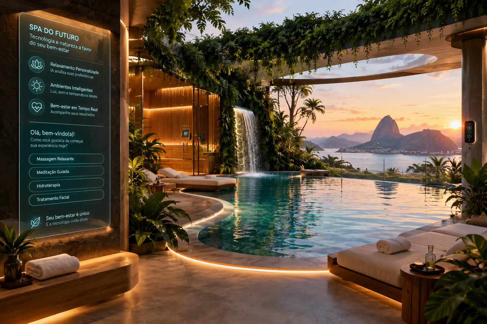

# SPA do Futuro: Uma Experiência Quase Real Criada com IA

## 📒 Descrição

Este projeto foi desenvolvido como parte do desafio **Lab DIO — Natural ou Fake Natty? Como Vencer na Era das IAs Generativas**.

A proposta consiste em imaginar um SPA inteligente do futuro, combinando bem-estar, tecnologia e inteligência artificial em uma experiência visual e textual que se aproxime da realidade.

O projeto explora como ferramentas de IA generativa podem criar imagens, textos e experiências digitais capazes de transmitir a sensação de um ambiente real, mesmo quando se trata de um conceito fictício.

## 🤖 Tecnologias Utilizadas

- **ChatGPT:** planejamento do projeto, elaboração de textos e criação de prompts.
- **Ferramenta de geração de imagens por IA:** criação de imagens conceituais realistas.
- **GitHub:** versionamento, documentação e publicação do projeto.
- **Markdown:** estruturação e formatação do README.

*Observação: as ferramentas serão ajustadas conforme os recursos efetivamente utilizados no projeto.*

## 🧐 Processo de Criação

O processo foi organizado em cinco etapas:

1. **Definição do conceito:** idealização de um SPA do futuro, com arquitetura integrada à natureza, ambientes de relaxamento e tecnologia discreta.
2. **Planejamento com IA:** elaboração de prompts para orientar a geração de conteúdos visuais e textuais.
3. **Produção dos conteúdos:** criação e seleção de materiais que transmitam realismo, coerência visual e uma experiência plausível.
4. **Documentação:** organização dos prompts, ferramentas e resultados obtidos.
5. **Publicação:** organização dos materiais no GitHub e preparação para submissão na plataforma da DIO.

## 🚀 Resultados

O resultado esperado é um conjunto de conteúdos digitais que represente um conceito de SPA inteligente do futuro, combinando criatividade, tecnologia e realismo visual.

Os materiais produzidos poderão incluir:

- Imagem conceitual de um SPA futurista integrado à natureza.
- Texto de apresentação da experiência.
- Prompts utilizados na criação dos conteúdos.
- Outros materiais visuais ou audiovisuais, conforme o desenvolvimento do projeto.

Os resultados finais serão documentados neste repositório após a produção e validação dos materiais.

## 💭 Reflexão

O desafio demonstra como a inteligência artificial generativa amplia as possibilidades de criação de conteúdos digitais realistas.

Entretanto, alcançar um resultado convincente exige mais do que gerar uma imagem ou um texto: é necessário planejar, elaborar bons prompts, avaliar os resultados e realizar ajustes para manter a coerência entre a ideia original e o material produzido.

A experiência também evidencia a importância da transparência na utilização da IA, diferenciando conteúdos sintéticos de registros reais.

Este projeto é conceitual e não representa um estabelecimento, serviço ou iniciativa comercial real.

## 🖼️ Conteúdo visual

Imagem conceitual criada com inteligência artificial generativa.

## 🎙️ Podcast — SPA do Futuro

Ouça o podcast sobre como a Inteligência Artificial Generativa pode transformar a experiência dos hóspedes em um SPA.

[⬇️ Baixar o podcast em MP3](./midias/podcast_audio.mp3)

**Arquivo:** `./midias/podcast_audio.mp3`

**Tema:** Inteligência Artificial Generativa, personalização, bem-estar, inovação e experiência dos hóspedes.

## 🎬 SPA do Futuro — Videopodcast | Versão 1

### Sobre o projeto

Este projeto explora como a Inteligência Artificial Generativa pode transformar a experiência dos hóspedes de um SPA, combinando tecnologia, personalização, bem-estar e atendimento humanizado.

O videopodcast apresenta uma visão conceitual de como a inteligência artificial, a Ciência de Dados e o Big Data podem apoiar experiências mais personalizadas, respeitando a privacidade e a segurança das informações.

### 🎥 Videopodcast

**Versão 1 — vídeo com narração, imagens e legendas.**

[Assistir ao videopodcast MP4](./midias/spa_do_futuro_v1.mp4)

### 🎧 Podcast original

[Arquivo de áudio MP3](./midias/podcast_audio.mp3)

### 🧠 Tecnologias e conceitos explorados

- Inteligência Artificial Generativa
- Ciência de Dados e Big Data
- Personalização da experiência do hóspede
- Automação e inovação em serviços de bem-estar
- Privacidade, segurança da informação e valorização do atendimento humano

### 📌 Status do projeto

**Versão 1 concluída:** videopodcast conceitual produzido com apoio de ferramentas de Inteligência Artificial Generativa.

Esta versão utiliza narração, imagens e legendas. Recursos adicionais, como avatar virtual animado, poderão ser explorados em versões futuras.

### ⚠️ Observação

O conteúdo apresenta uma proposta conceitual e não representa a implantação de um sistema real de IA no SPA.

Projeto desenvolvido como parte do desafio educacional da DIO sobre Inteligência Artificial Generativa.

## 🤖 Uso responsável da Inteligência Artificial

Este projeto é conceitual e utiliza recursos de IA Generativa para explorar possibilidades de inovação no setor de bem-estar e hospitalidade. As imagens, os roteiros e as demais peças produzidas com IA devem ser identificados de forma transparente. A tecnologia é apresentada como ferramenta de apoio à criatividade e à experiência humana, e não como substituta do atendimento profissional.
